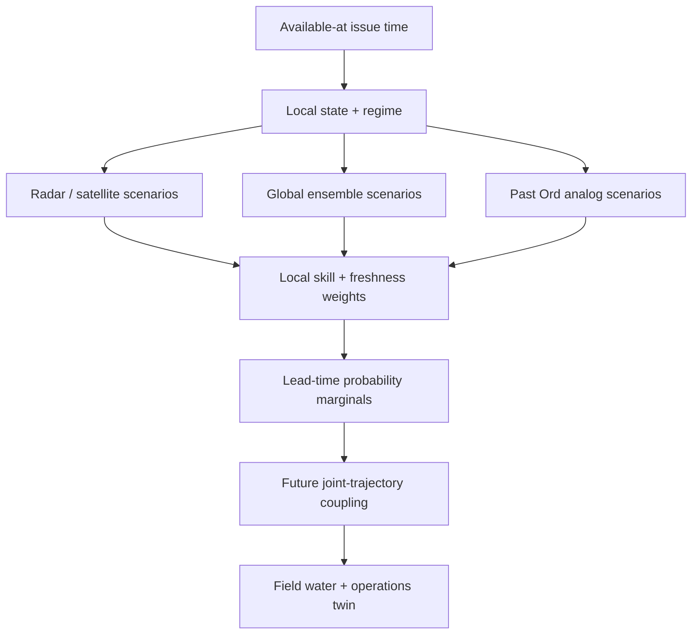

# OrdCast RET

An experimental software scaffold for an intended **Regime–Event–Twin** weather
forecasting system for farms in Kununurra and the Ord River district.

OrdCast does not try to rerun a global atmosphere model on a laptop. Global
ensembles supply the large-scale possibilities; OrdCast is designed to learn which
sources work locally, build coherent local weather scenarios, and translate those scenarios
into farm decisions such as spray-window survival, irrigation demand, heat exposure,
trafficability, and wet-season progress.

> **Research status:** this repository is not an official Bureau of Meteorology
> forecast and must not yet be used for safety-critical decisions. The first slice is
> a tested lead-by-lead marginal-fusion engine and hindcast framework, not a trained
> operational forecast model.

## What is new here

Most weather apps show one best estimate. The intended full OrdCast will retain whole
futures. Its three planned layers are:

1. **Regime** — will estimate probabilities for local dry trade, build-up convection,
   monsoon break, active monsoon, and tropical-low environments.
2. **Event** — will represent storms as coherent onset, duration, path, amount, and gust
   events rather than unrelated hourly rain values.
3. **Twin** — will run every weather scenario through a mass-conserving field water and
   operations model.

Every source earns a separate weight at every forecast horizon through past local
probabilistic skill. Stale inputs fade. Local analogs may use only cases whose outcomes
were already available at the issue time. Output is a lead-specific distribution—
P10/P50/P90 and threshold probabilities rather than only one best number. The current
v0.1 weights can differ by lead, so its rows are not yet coherent joint trajectories
and must not be used for event-path or farm-twin calculations. A documented exact
empirical-CDF projection keeps cumulative rainfall physically non-decreasing without
inventing interpolated tail mass.

## Implemented in v0.1

- `ordcast.types`: validated source and fused lead-time distributions.
- `ordcast.skill`: horizon-specific prequential CRPS ledger and freshness weighting.
- `ordcast.fusion`: lead-specific marginal mixtures preserving spread and tails.
- `ordcast.analog`: robust-distance local analogs with target-maturity cut-offs.
- `ordcast.evaluation`: forecast-first, learn-after walk-forward hindcasts.
- `ordcast.metrics`: ensemble CRPS and Brier score.
- `pipelines.ingest.silo_daily`: validated, immutable Kununurra Aero SILO snapshots.
- `pipelines.ingest.live_archive`: bounded live collection plans and raw-data recorder.
- `ordcast.archive`: append-only, content-addressed source archive with provenance.
- `ordcast.daily_baseline`: 1/3/7-day seasonal-and-antecedent rain analog baseline.
- `POST /v1/marginals`: versioned FastAPI marginal-fusion endpoint.
- Stationary radar persistence retained only as a mandatory benchmark baseline.
- Unit and integration tests plus a valid GitHub Actions workflow.
- Persistent one-PC collection, health status, and overlap protection.
- Real DirectML/CUDA arithmetic and inference-provider checks.

## Architecture



The current release implements a common source contract for cumulative rainfall from
issue time through each horizon, the analog path, marginal fusion, verification, and
API. Joint trajectory coupling, regime classification,
additional data adapters, event generation, calibration, physical constraints, and
the farm twin are the next milestones.

## Quick start

Requires Python 3.11 or newer.

```bash
python -m venv .venv
source .venv/bin/activate
python -m pip install -c requirements.lock.txt -r requirements-dev.txt
python -m pytest -q
python -m examples.ordcast_demo
uvicorn serve.api_fastapi:app --reload
```

Open `http://127.0.0.1:8000/docs` for the interactive API.
Requests are capped at 1 MB, 16 sources, 512 members per source, and 64 horizons;
production ingress must enforce the same body limit.

Example request:

```bash
curl -s http://127.0.0.1:8000/v1/marginals \
  -H 'content-type: application/json' \
  -d '{
    "horizons_hours": [1, 6, 24],
    "sources": [
      {
        "name": "satellite_radar",
        "members_mm": [[0, 4, 12], [2, 10, 35]],
        "recent_crps": [1.0, 3.0, 10.0],
        "age_hours": 0.25,
        "half_life_hours": 1.5
      },
      {
        "name": "global_ensemble",
        "members_mm": [[0, 2, 15], [1, 8, 45], [3, 18, 75]],
        "recent_crps": [4.0, 4.0, 7.0],
        "age_hours": 2,
        "half_life_hours": 12
      }
    ]
  }'
```

## First real-data baseline

SILO requires a contact email on point-data API requests. Keep it in an environment
variable rather than source control. The downloader creates the raw response and a
`.manifest.json` sidecar exclusively (never overwriting either); the manifest records
retrieval time in UTC, SHA-256, row coverage, and non-sensitive request parameters:

```bash
export SILO_USERNAME='your-contact-email@example.com'
python -m pipelines.ingest.silo_daily \
  --station 2056 \
  --start 1971-01-01 \
  --finish 2026-08-11 \
  --out data/silo/kununurra-aero-rain-1971-2026.csv

python -m pipelines.baseline.silo_daily_analog \
  --csv data/silo/kununurra-aero-rain-1971-2026.csv \
  --analogs 40
```

This is a daily climatology/analog benchmark for Kununurra Aero station 2056, not a
live storm forecast. It matches day of year plus 7/30-day antecedent rain state and
returns 1/3/7-day cumulative rain distributions. The query defaults to 09:00 AWST on
the day after the snapshot's last date. Conservatively, features use rows only through
`issue_date - 1`, the issue-date row is skipped, and targets begin at `issue_date + 1`.
SILO station series patch missing observations with interpolated values and may revise
history, which is why exact snapshot bytes and source codes are retained. A current
snapshot supports present-day analog inference and climatology only. The CLI rejects
historical issue dates because a vintage-correct hindcast requires the snapshot that
was actually available at each old forecast cutoff.

## Honest verification contract

A forecast model is not promoted unless it beats the strongest simple baseline on
predeclared targets with blocked, rolling wet-season hindcasts. Rules:

- each record stores `event_time`, `available_at`, model cycle, member, and version;
- only data with `available_at <= issue_time` may become a feature;
- fit scalers, regimes, feature selection, and calibration inside each training fold;
- keep complete storm events together and purge overlapping target windows;
- train only on targets whose verification interval had ended before the test issue;
- report build-up, wet, and dry periods separately;
- score distributions with CRPS, probabilities with Brier/reliability, and quantiles
  with pinball loss and interval coverage;
- compare against climatology, persistence, raw ensemble, simple bias correction, and
  radar/satellite advection for the short range.

The first target scorecard is 24-hour rainfall CRPS and Brier skill for rain above
10 mm at days 1–5, plus timing error for first rain. Farm outputs follow once the
meteorological primitives have demonstrated out-of-sample skill.

## Data plan

The initial open-data path is:

- Kununurra Aero observations and farm sensors for local truth;
- SILO snapshots for long daily climatology and labels;
- Himawari-8/9 native imagery for cloud growth and movement;
- Wyndham radar for an optical-flow prototype, with its range/clutter/attenuation
  limits kept visible;
- archived issued GEFS/GFS and ECMWF IFS/AIFS ensembles for operational scenarios;
- GEFSv12 reforecasts for an initial 2000–2019 rolling hindcast;
- BARRA2/ERA5/IMERG as training context or verification, never as historical inputs
  pretending they were available before issue time;
- RONI, DMI, and continuous MJO RMM1/RMM2 for longer-range regime forecasts.

Bureau public-feed terms and subscriber products need a licensing decision before a
commercial or public service. Raw forecast inputs will be archived immutably from day
one because several free operational feeds retain only recent cycles.

## Local PC weather station

The supported starter deployment is now a normal Windows PC with a local data drive.
It records Kununurra Airport observations, all 31 regional GEFS members, and native
Himawari-9 infrared segment 7. It freezes exact issue/scan times, retains response
bytes and availability metadata, and refuses overwrites. No AWS or Cloudflare account
is required.

On Windows, double-click **ops\windows\INSTALL-ORDCAST-LOCAL.cmd**. It creates fresh,
versioned collector and DirectML GPU environments, checks real GPU arithmetic, and
registers a limited current-user task that stores data locally every six hours. No
administrator approval is required. The stable status shortcut is copied to
**%LOCALAPPDATA%\OrdCast\ORDCAST-STATUS.cmd**.

See [the local PC guide](docs/LOCAL_PC.md) for plain-language setup and hardware
boundaries, and [the archive contract](docs/LIVE_ARCHIVE.md) for source-specific
rainfall semantics.

## Persistence benchmark

The old stationary-radar code remains as a deliberately weak baseline:

```bash
python -m pipelines.nowcast.persistence_nowcast \
  --demo \
  --out outputs/nowcast_60min.nc
```

It is not the operational forecast. Real-data geolocation and radar quality control
remain unfinished; the synthetic latitude/longitude helper is for demonstrations only.

## Roadmap

1. Run and monitor the local PC archive through the 2026–27 wet season.
2. Decode the local archive and issue raw GEFS shadow forecasts.
3. Train an RX-6600-XT DirectML bias correction and beat the raw-NWP baseline.
4. Add rolling GEFSv12 wet-season hindcasts with confidence intervals.
5. Add Himawari cloud-growth and Wyndham radar motion scenarios for 0–6 hours.
6. Train the Ord regime gate and coherent event generator.
7. Add physical constraints and the field water/operations twin.
8. Shadow-run forecasts through the 2026–27 wet season before operational claims.

## Name transition

The repository is still named `Weather-wizard` for compatibility. The model and API
are now called **OrdCast RET**. A repository rename can follow after the architecture is
accepted.

### Experimental raw GEFS shadow baseline

The offline [GEFS shadow baseline](docs/GEFS_SHADOW.md) now decodes archived
rainfall into the existing forecast contract, with full-member and availability
checks. This is uncalibrated and unvalidated; it does not make OrdCast operational.
